# Hotel Management System — C Programming

**My individual contribution: Hotel Staff Management Module**  
**Language:** C · **Application:** Console-based hotel operations · **Institution:** Asia Pacific University (APU)

## Overview

I independently developed the **Hotel Staff module** of a larger, group-based Hotel Management System as part of my Introduction to C Programming coursework. My work focused on the operational workflows hotel employees need to manage bookings, guests, rooms, and reports through a menu-driven console interface.

> **Authorship clarification:** The original university submission was a group assignment. The Hotel Staff section (Section 3.0) is explicitly attributed to me, Fairouz Abdulrahman Hamed Mousa. The Administrator, Customer, and Guest sections were attributed to other group members. This repository showcases **my independently developed module**, not sole authorship of the full integrated group system.

## Features I Developed

| Feature | Description |
|---|---|
| Staff menu | Console menu routing to hotel operations, with invalid-choice handling |
| Authentication | Username/password checks using text-file records and role-based menu navigation |
| Logout | Session-state reset and feedback |
| Reservation management | Display, update, and cancel existing reservations |
| New bookings | Check room availability and booking-date conflicts before recording a reservation |
| Guest check-in / check-out | Handle arrival and departure operations |
| Room availability | Find available rooms |
| Booking history | Review stored reservation history |
| Room information updates | Modify room information from the staff interface |
| Reports | Generate hotel-operation reports |

## Technologies and Concepts

- **C programming:** functions, `switch` statements, loops, arrays, and structures
- **File handling:** `fopen`, `fscanf`, `fprintf`, and `fclose` for text-based persistence
- **Role-aware workflows:** navigation from login to staff-specific operations
- **Input handling:** menu choices, identifiers, and reservation dates
- **Data structures:** records for rooms, users, and reservations

## System Screenshots

### Staff menu
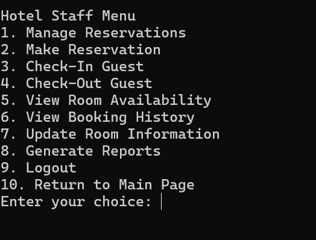

### Reservation management
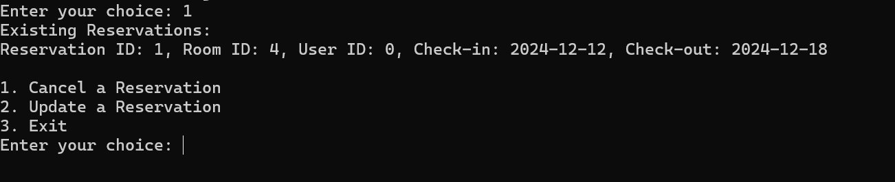

### Booking a room
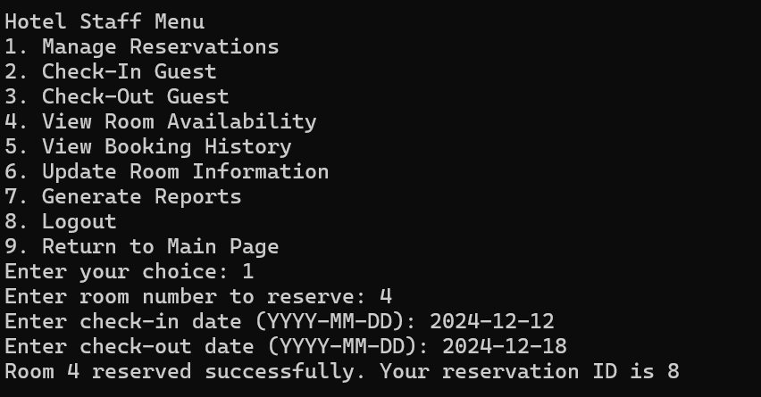

### Guest check-in and check-out
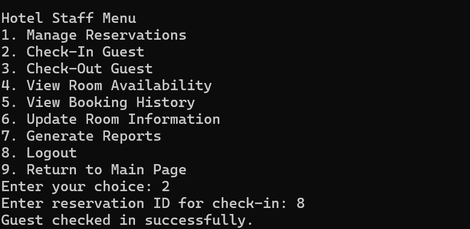
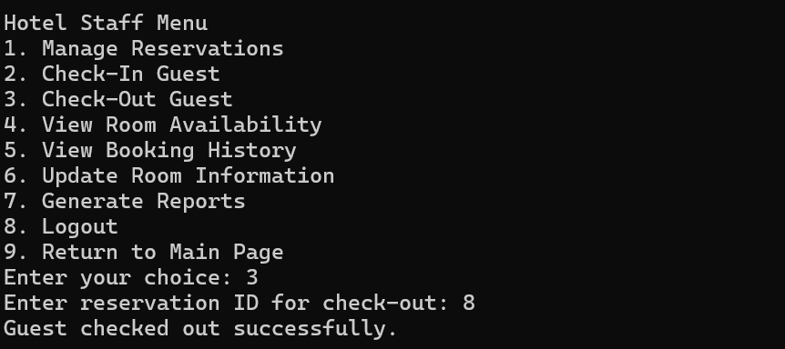

### Room availability and booking history
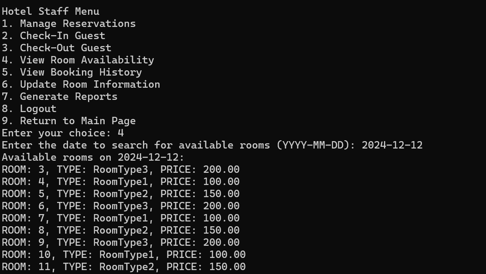
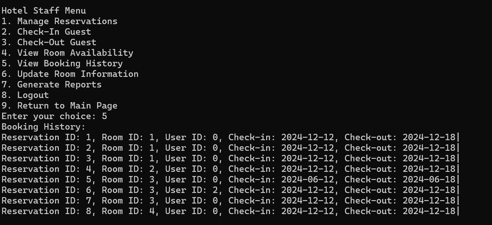

### Room updates and reports
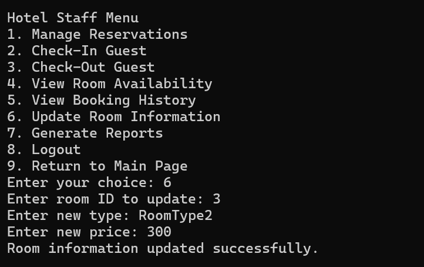
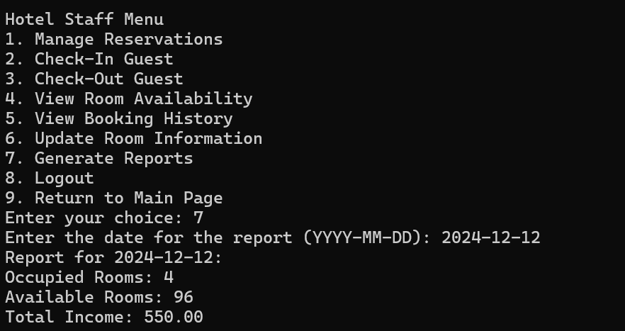

## Design and Implementation Evidence

### Staff menu implementation
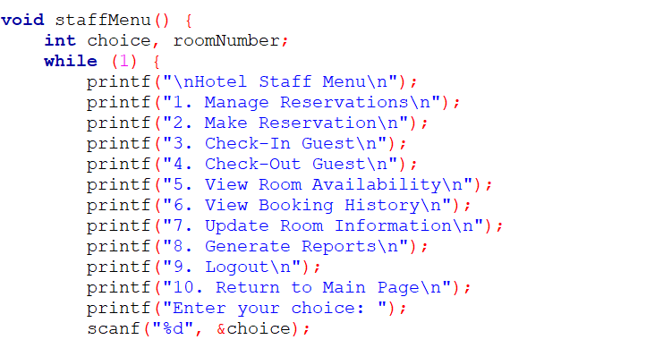

### Reservation logic
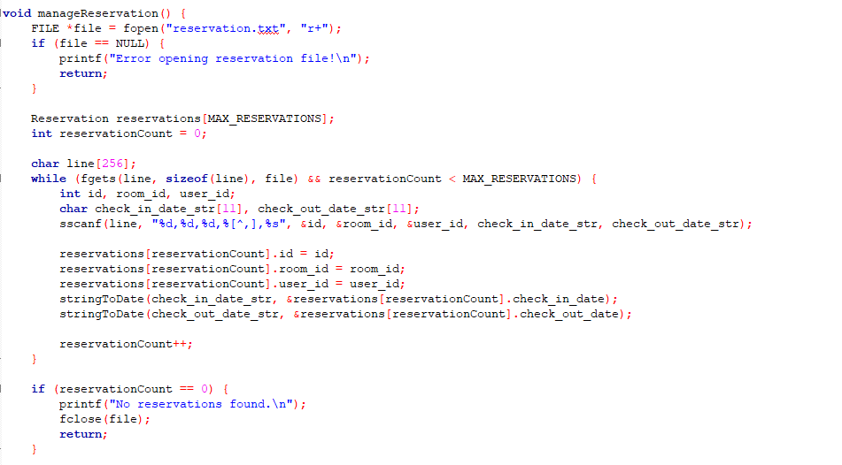

### Booking implementation
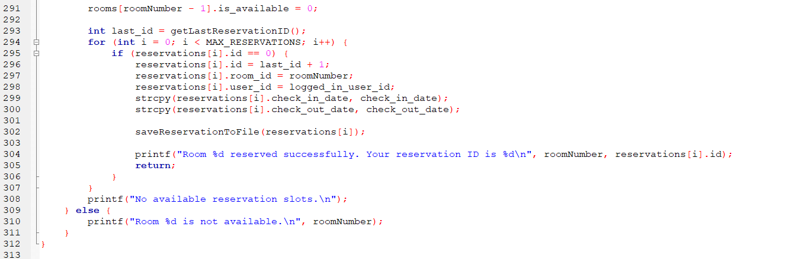

### Staff menu flowchart
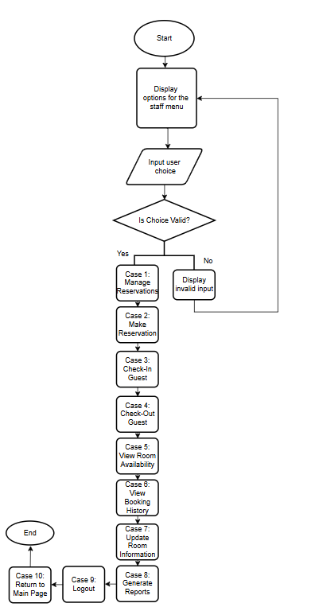

### Reservation flowchart
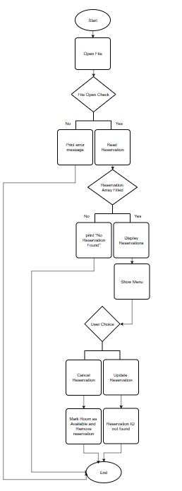

## How the Module Works

1. An authorized user signs in and is routed to the relevant role-specific menu.
2. Hotel staff select an operation from the console menu.
3. Reservation functions read stored records, check relevant room and date details, and perform the requested action.
4. Changes are written back to text files as appropriate.
5. Staff can review booking history, update room details, generate reports, or log out.

## What I Learned

Developing this module strengthened my practical understanding of **procedural programming in C**, file-based record management, modular functions, user-input handling, and designing interconnected workflows for a real-world operational scenario.

## Documentation and Scope

The images in this repository are extracted from **Section 3.0 — Hotel Staff** of my original assignment report, including implementation screenshots, console outputs, and flowcharts. The uploaded report contains images of code, **not a separately provided, verified buildable `.c` source file**. Accordingly, this repository is a documented project showcase rather than a ready-to-compile release.

**Academic context:** Introduction to C Programming (`CT018-3-1-ICP`), Asia Pacific University.

**Individual module developer:** Fairouz Abdulrahman Hamed Mousa.
